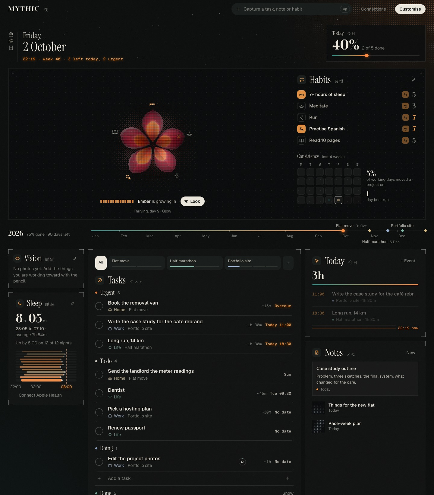
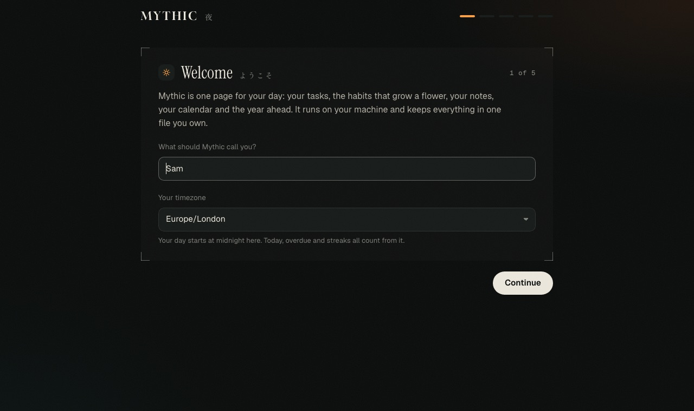

# Mythic

One page for your day: your tasks, the habits that grow a flower, your notes, your calendar, your sleep and the year ahead. Mythic runs on your own machine, keeps everything in one SQLite file you own, and connects to the things you already use.



- **Tasks** with projects, areas (work, life, home), due days and times, estimates, repeats, priority, and a play/stop clock. Each project gets a button with this week's progress.
- **Habits and the flower.** Up to five habits, one petal each. Tick a habit and its petal grows; miss days and it tears. Good days in a row earn new colours, worlds and visitors.
- **Today**, a timetable of what is timed today with the free time between, and a **calendar** month with your tasks, project deadlines and connected calendars.
- **Notes**, a **vision board** of your own photos, **sleep** (typed or from Apple Health) and a **year line** with your project deadlines.
- **Customise**: drag widgets between zones, add and remove them. Press ⌘K anywhere to capture a task, note or habit.

Nothing on the page is made up: an empty widget says it is empty and tells you how to fill it.

## Quick start

You need [Node.js](https://nodejs.org) 20.9 or newer.

```bash
git clone https://github.com/CyberGuyy/mythic-app.git mythic
cd mythic
npm install
npm run build
npm start
```

Open <http://localhost:3000>. The first visit runs a short setup: your name and timezone, a few projects, your habits, your first tasks and, if you like, a calendar. Everything but the timezone can be skipped and added later.



For development, `npm run dev` runs it with hot reload on port 3000.

### With Docker

```bash
docker compose up -d
```

Your data lives in the `mythic-data` volume. The compose file publishes Mythic on `127.0.0.1:3000` only; see [Opening it to other devices](#opening-it-to-other-devices) before you change that.

## Connections

Mythic works on its own. Each connection is optional and set up on the **Connections** page (top bar). Keys stay in your own database.

| Connection | What it does | What you need |
|---|---|---|
| **Calendars** | Shows your events on the Calendar and Today widgets, refreshed every 15 minutes. Read only. | The private iCal (.ics) address of a Google, iCloud, Outlook, Fastmail or any other calendar. |
| **Telegram** | Message your own bot and the line becomes a task (`work:`, `life:`, `home:` to file it, `note:` for a note, `/today` for the day). Tasks with *Remind me* on are sent to you there at their time. | A bot token from [@BotFather](https://t.me/BotFather). Mythic polls Telegram, so it works on a laptop behind a router. |
| **API** | Add and change tasks, add notes, tick habits and read the list from your own scripts, an iOS Shortcut, Raycast, Zapier or anything that sends a web request. | A token made on the Connections page. |
| **Apple Health sleep** | Nights from your iPhone or Watch on the Sleep widget. Nights you typed yourself are never overwritten. | An iPhone Shortcut that sends Sleep Analysis to `/api/v1/sleep`, or saves it to iCloud Drive as `Shortcuts/Mythic/sleep.txt` when Mythic runs on your Mac. |

### Finding a calendar's iCal address

- **Google Calendar:** Settings, pick the calendar under *Settings for my calendars*, then *Integrate calendar*, and copy the *Secret address in iCal format*.
- **iCloud:** in Calendar, share the calendar, turn on *Public Calendar* and copy the `webcal://` link.
- **Outlook:** Settings, Calendar, Shared calendars, *Publish a calendar*, then copy the ICS link.

The reader handles time zones (including Outlook's Windows names), all-day and multi-day events, recurring events (`RRULE` with daily, weekly, monthly and yearly rules, `BYDAY`, `BYMONTHDAY`, `COUNT`, `UNTIL`), exceptions (`EXDATE`), moved or cancelled occurrences and cancelled events.

## API

Make a token on the Connections page, then send it as a bearer token. Everything is JSON.

```bash
TOKEN=myth_...
curl -X POST http://localhost:3000/api/v1/tasks \
  -H "Authorization: Bearer $TOKEN" -H "Content-Type: application/json" \
  -d '{"title": "Book the dentist", "due_day": "2026-10-09", "due_time": "10:00"}'
```

| Request | Body or query | Does |
|---|---|---|
| `GET /api/v1/tasks` | `?view=all\|today\|upcoming\|none\|done` | Lists tasks with their group (overdue, today, upcoming, none, done_week). |
| `POST /api/v1/tasks` | `{ "title", "due_day"?, "due_time"?, "section"?, "project"?, "detail"?, "estimate_minutes"?, "repeat"?, "is_priority"? }` | Adds a task. `project` is a project name (or id); `section` is `work`, `life` or `home`; `repeat` is `none`, `daily`, `weekly` or `monthly`. |
| `POST /api/v1/tasks` | `{ "line": "home: water the plants" }` | Adds a task from one line, the way the add line on the page does. |
| `POST /api/v1/tasks` | `{ "action": "done" \| "delete" \| "snooze" \| "start" \| "stop" \| "rename", "id" }` | Changes one task. `done` on a done task opens it again; on a repeating task it moves to its next date. |
| `GET /api/v1/notes` | | Lists notes, newest first. |
| `POST /api/v1/notes` | `{ "title", "body"? }` | Adds a note. |
| `GET /api/v1/habits` | | Today's habits and whether each is ticked. |
| `POST /api/v1/habits` | `{ "name" }` or `{ "id" }`, `"on": false` to untick | Ticks a habit for today. |
| `POST /api/v1/sleep` | `{ "samples": "start \| end \| value\n..." }` or an array of `{ start, end, value }` | Turns Apple Health Sleep Analysis samples into nights. |

Errors come back as `{ "error": "..." }` with a 4xx status, in words you can show to a person.

### An iOS Shortcut that adds a task

1. New Shortcut, add *Ask for Input* (text, "What needs doing?").
2. Add *Get Contents of URL*: `https://your-mythic/api/v1/tasks`, method POST, header `Authorization: Bearer <token>`, request body JSON with a field `line` set to *Provided Input*.
3. Add it to your home screen or ask Siri to run it.

This needs Mythic to be reachable from your phone (see below).

## Opening it to other devices

Out of the box Mythic listens on `127.0.0.1` and only answers requests addressed to `localhost`. That is the safe default for a personal app on a laptop. To use it from your phone or host it on a server:

1. Set a password: `MYTHIC_PASSWORD=a-long-passphrase`. Mythic then asks for it once per device and keeps you signed in for 30 days.
2. Listen on your network: `HOST=0.0.0.0 npm start` (with Docker, change the port mapping to `"3000:3000"`).
3. Put HTTPS in front of it before it leaves your home network: a reverse proxy such as [Caddy](https://caddyserver.com) (`reverse_proxy localhost:3000`), or a tunnel such as Tailscale or Cloudflare Tunnel.

All settings are environment variables; [`.env.example`](.env.example) lists them.

## Your data

Everything lives in the data folder (`./data`, or `MYTHIC_DATA_DIR`): `mythic.db` and the vision board photos. Back up that folder. **Connections → Download my data** gives you everything as JSON, without the connector keys.

## How it is built

Next.js 16 (App Router), React 19 and SQLite through better-sqlite3, in plain JavaScript. No external services, no telemetry, no AI calls.

```
app/                pages (dash, welcome, settings, login) and API routes (app/api)
components/dash/    the Dash: shell, zones, widgets, the composer
lib/                domain logic, each module with its tests beside it
lib/dash/           one loader per widget; widgets.js is the registry
lib/connectors/     calendar (iCal reader), Telegram, API token
lib/tasks/          the task store, actions and clock
proxy.js            sign-in and the localhost rule
instrumentation.js  starts the background worker (calendars, reminders, Telegram)
```

Adding a widget is one entry in `lib/dash/widgets.js` (its loader), one component in `components/dash/widgets/` and one stylesheet in `app/dash/widgets/`.

```bash
npm test        # unit tests (node --test)
npm run lint
npm run build
```

## What is not here (yet)

Mythic started as a personal system with an agent engine behind it: proactive suggestions, research, drafting and session hand-offs. That engine is still being built and is not part of this release. This repository is the dashboard and its connections, ready to use on their own.

## License

[MIT](LICENSE)
